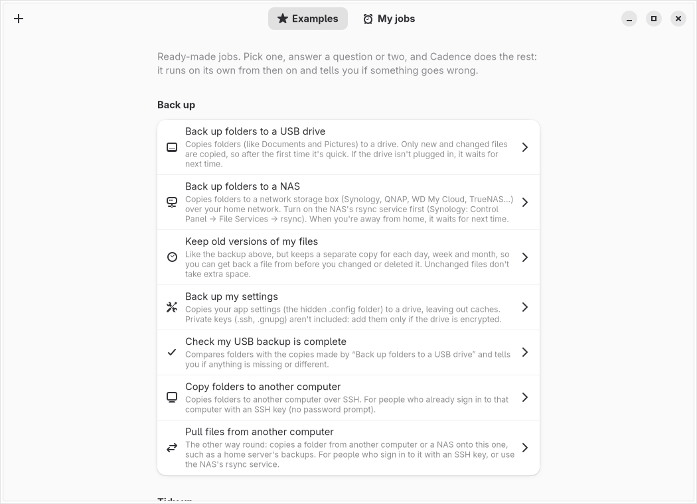
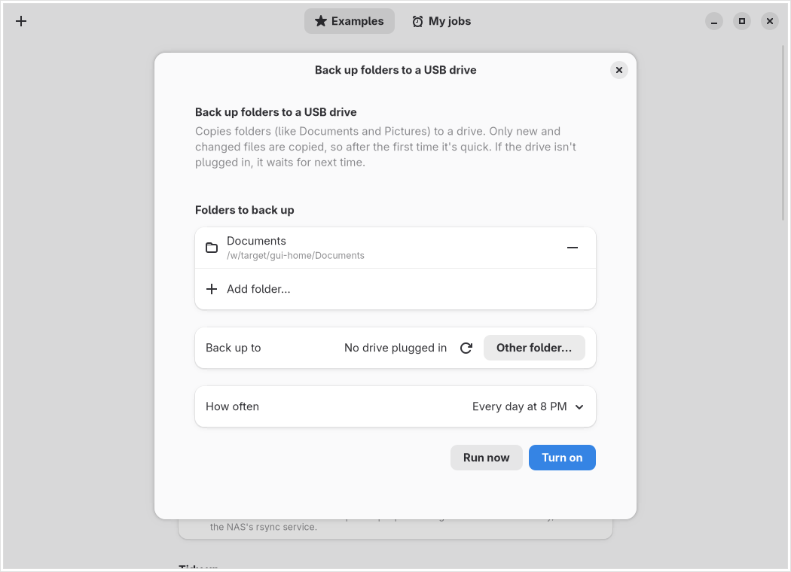
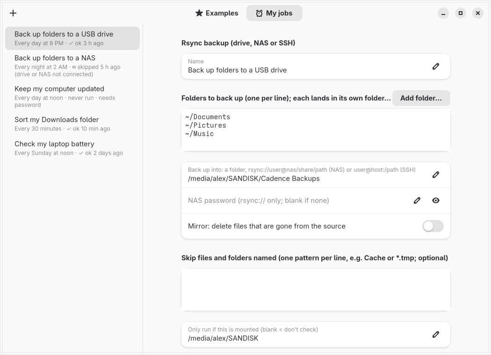

# Cadence

Run backups, clean-ups, updates and scripts on a schedule, without having to learn Linux.

Open **Examples**, pick a job, answer a question or two (which folders, which drive), choose how often, and press **Turn on**. From then on it runs by itself. A desktop notification tells you if a run ever goes wrong.





## Examples included

| Back up | Tidy up | Keep healthy | Handy tools |
|---|---|---|---|
| Back up folders to a USB drive | Sort my Downloads folder | Keep my computer updated | What's using my disk space? |
| Back up folders to a NAS | Empty old things from the trash | Tell me when updates are available | Find my biggest files |
| Keep old versions of my files | Clear old cache files | Check my drives' health | Show my computer's details |
| Back up my settings | Delete old files from a folder | Check my laptop battery | What's slowing my computer down? |
| Check my USB backup is complete | Free up space from old system files | Warn me when my disk is nearly full | Check my internet connection |
| Copy folders to another computer | | | Show my network addresses |
| Pull files from another computer | | | What's listening on my network? |
| | | | Sync my notes with git |

**Run now** tries any example once and shows what it printed, without scheduling anything.

### Backups

Every backup is done with rsync, so after the first run only new and changed files are copied.

- **More than one folder:** a backup can include as many folders as you like. Each one lands in the backup under its own name, for example `Cadence Backups/Documents` and `Cadence Backups/Pictures`.
- **NAS backups** use the NAS's built-in rsync service, which Synology, QNAP, WD My Cloud and TrueNAS all have. Turn it on in the NAS settings (Synology: Control Panel → File Services → rsync), then give Cadence the NAS address, the shared folder, and a NAS user name and password. The password is kept in a file only you can read, never in the script.
- **Back up my settings** copies your hidden `.config` folder and leaves out app caches. It doesn't copy private keys (`~/.ssh`, `~/.gnupg`). Add those only if the backup drive is encrypted.
- **Away from home:** when the drive isn't plugged in or the NAS can't be reached, a backup skips quietly and tries again. If there's been no successful backup for a week, you get one reminder a day until there is.

### Missed runs

A computer that's asleep or off can't run anything. Daily, weekly and monthly jobs therefore **make up missed runs**: once an hour Cadence checks whether a job missed its last scheduled time, and if so runs it then. A laptop that's always closed at 8 PM still gets its nightly backup the next morning. A job that failed isn't retried every hour, only once per period. Each job has a switch to turn this off.

## For people who know Linux



**My jobs** has the full editor:
- your own bash scripts
- any cron schedule (under *Advanced*)
- rsync of several folders at once, with exclude patterns, to a local folder, a NAS (`rsync://user@nas/share/path`) or `user@host:/path` over SSH
- rsync pulls from another machine
- hard-linked snapshots with daily, weekly and monthly retention
- jobs that run as root
- a ping URL after each run, for Healthchecks.io and similar dead-man's-switch services

**View script** shows exactly what will run.

Where things live:

| | Your jobs | Root jobs |
|---|---|---|
| Schedule | a marked block in your crontab (other lines untouched) | `/etc/cron.d/cadence` |
| Scripts | `~/.local/share/cadence/jobs/` | `/usr/local/lib/cadence/` |
| Logs | `~/.local/state/cadence/` | `/var/log/cadence/` |

**Run history:** every run is logged with its exit code. If a run is still going when the next one is due, the next one is skipped rather than overlapping. Exit code 75 means "skipped" (drive or NAS not there): it isn't treated as a failure.

**Root jobs and security:** Cadence itself never runs as root. When you save a job that runs as root, it asks for your password through Polkit (`pkexec`) and installs the script into `/usr/local/lib/cadence/`, owned by root and writable only by root. Cron runs that copy, never a file in your home folder, so a program running as you can't change what runs as root without asking for the password again. Cadence only asks when something root-owned actually changes.

**Notifications from cron:** cron runs jobs without your desktop session, which is why `notify-send` from cron usually shows nothing. Each generated script points `notify-send` at your session bus (`/run/user/<uid>/bus`). Root jobs send theirs as you, via `runuser`. A notification is sent when a run fails, when a skipped backup hasn't succeeded for a week, and on success if you ask for it.

### From the terminal

```sh
cadence --list     # every job, its schedule and its last run
cadence --apply    # rebuild the scripts and crontab from ~/.config/cadence/jobs.json
```

`jobs.json` holds everything about your jobs, so moving to a new computer is: copy it to `~/.config/cadence/`, then run `cadence --apply`. Be careful about keeping it in a public dotfiles repository: NAS passwords are stored in it (the file is readable only by you).

## Install

Download the file for your system from the [latest release](https://github.com/Stolly345/cadence/releases/latest) (64-bit x86 only), open a terminal in the folder you saved it to (usually `cd ~/Downloads`), and run:

| System | File | Command |
| --- | --- | --- |
| Ubuntu 24.04 or newer, Debian 13 (trixie) or newer | `cadence_0.3.0-1_amd64.deb` | `sudo apt install ./cadence_0.3.0-1_amd64.deb` |
| Fedora 40 or newer | `cadence-0.3.0-1.x86_64.rpm` | `sudo dnf install ./cadence-0.3.0-1.x86_64.rpm` |
| openSUSE Tumbleweed | `cadence-0.3.0-1.x86_64.rpm` | `sudo zypper install --allow-unsigned-rpm ./cadence-0.3.0-1.x86_64.rpm` |
| Arch, Manjaro, EndeavourOS, CachyOS | (none to download) | see **Arch** below |

The `./` matters: it tells the package manager you mean the downloaded file, and it fetches everything else Cadence needs. Upgrading uses the same command; afterwards run `cadence --apply` once so your existing jobs get the new version's scripts.

**Arch:** build the `cadence-bin` package from this repo (it repackages the release's `.deb`, nothing compiles), then turn cron on once:

```sh
sudo pacman -S --needed git base-devel
git clone --depth 1 https://github.com/Stolly345/cadence && cd cadence/packaging/aur
makepkg -si
sudo systemctl enable --now cronie
```

**Debian/Ubuntu: use `apt`, not `dpkg -i`.** dpkg doesn't download dependencies, so it stops with a "not installed" error. If that already happened, run `sudo apt -f install` to finish.

Cadence runs jobs with cron. Ubuntu, Debian, Fedora and openSUSE have it running already; on Arch, the last command above starts it. Until cron is running, Cadence shows a warning bar saying how to start it.

**Not supported:** Ubuntu 22.04, Debian 12, RHEL/Rocky/Alma 9 and Arm (their GTK or libadwaita is too old, or there's no build).

## Good to know

- **Sort my Downloads** uses [Magpie](https://github.com/Stolly345/magpie) if it's installed, which makes every sort undoable. Otherwise it uses its own sorter, which never overwrites anything and skips files from the last hour.
- **System updates** work with apt (Ubuntu/Debian), dnf (Fedora) and zypper (openSUSE).
- **Check my drives' health** needs the `smartmontools` package. Many USB drive enclosures don't pass health data through; those are listed as "can't read", never reported as failing.

## Build

```sh
make packages      # .deb, .rpm and Arch package, built in an Ubuntu 24.04 container, each install-checked
cargo test         # 19 tests; most run the generated bash scripts for real (incl. an rsync-daemon NAS and a git remote)
tools/gui.sh '…'   # drive the app on a virtual display and take screenshots (IMAGE=cadence-gui-arch for current GTK)
```

## License

MIT or Apache-2.0, at your option.
